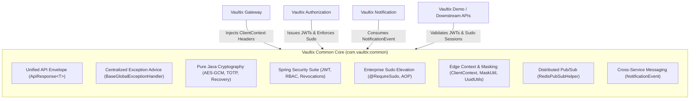

# Vaultix Common Core Library

[](https://openjdk.org/)
[](https://spring.io/projects/spring-boot)
[](https://spring.io/projects/spring-cloud)
[](https://projectlombok.org/)
[](https://opensource.org/licenses/Apache-2.0)

The foundational, shared core library for the **Vaultix** distributed identity, authorization, and microservices ecosystem. It delivers unified API envelopes, enterprise exception handling, pure Java cryptography (TOTP, AES-256 GCM, Recovery Codes), high-performance edge context utilities, Redis pub/sub invalidation, step-up Sudo session elevation, and a production-grade Spring Security OAuth2 Resource Server suite.

---

## Library Metadata

| Attribute | Specification |
| :--- | :--- |
| **Group ID** | `com.vaultix` |
| **Artifact ID** | `common` |
| **Version** | `0.0.1` |
| **Target Runtime** | Java 27 (OpenJDK / Amazon Corretto 27) |
| **Spring Framework** | Spring Boot `4.1.2` / Spring Cloud `2025.1.4` |
| **Packaging** | Reusable Library JAR (installed to local `.m2` repository) |

---

## Architectural Role in Vaultix

`com.vaultix:common` serves as the universal contract and shared security core across all services:



---

## Directory Structure

```text
common/
├── pom.xml
├── README.md
├── docs/
│   └── MODULES.md
└── src/main/java/com/vaultix/common/
    ├── constant/
    │   ├── CommonHeaders.java                 /* Standard X-Client-IP, X-Device-* header constants */
    │   └── SecurityTopics.java                /* Redis pub/sub channels for security revocations */
    ├── crypto/
    │   ├── AesGcmCryptoUtil.java              /* Authenticated AES-256 GCM encryption & decryption */
    │   ├── RecoveryCodeUtil.java              /* High-entropy, unambiguous MFA recovery codes */
    │   └── TotpUtil.java                      /* Pure Java RFC 6238/4226 TOTP engine with replay guard */
    ├── dto/
    │   ├── ApiResponse.java                   /* Immutable Java 27 record envelope with fluent builder */
    │   └── notification/
    │       ├── NotificationChannel.java       /* Delivery medium enum: EMAIL, SMS, PUSH, IN_APP */
    │       └── NotificationEvent.java         /* Validated messaging payload for RabbitMQ */
    ├── exception/
    │   ├── BadRequestException.java           /* HTTP 400 business validation error */
    │   ├── BaseGlobalExceptionHandler.java    /* Extensible @RestControllerAdvice base class */
    │   ├── ResourceConflictException.java     /* HTTP 409 conflict error */
    │   ├── ResourceNotFoundException.java     /* HTTP 404 missing resource error */
    │   └── SudoRequiredException.java         /* HTTP 403 step-up sudo required error */
    ├── security/
    │   ├── CommonJwtDecoderFactory.java       /* NimbusJwtDecoder builder for remote & in-memory JWKS */
    │   ├── CommonSecurityExpressions.java     /* SpEL constants for @PreAuthorize rules */
    │   ├── CustomAccessDeniedHandler.java     /* RFC 7807-aligned HTTP 403 JSON handler */
    │   ├── CustomAuthenticationEntryPoint.java/* Clean HTTP 401 JSON authentication entry point */
    │   ├── CustomJwtAuthenticationConverter.java /* Extracts roles & permissions with live revocation check */
    │   ├── JwtBlacklistValidator.java         /* OAuth2 token validator rejecting revoked JTIs */
    │   ├── PermissionRevocationService.java   /* In-memory permission revocation contract */
    │   ├── RedisPermissionRevocationService.java /* Caffeine L1 + Redis hash L2 permission revocation store */
    │   ├── RedisRoleRevocationService.java    /* Caffeine L1 + Redis hash L2 role revocation store */
    │   ├── RedisSudoService.java              /* Redis-backed step-up sudo session store */
    │   ├── RedisTokenBlacklistService.java    /* Pipelined Redis token blacklist store */
    │   ├── RequireSudo.java                   /* Method/class annotation demanding active sudo elevation */
    │   ├── RequireSudoAspect.java             /* Spring AOP around advice validating session elevation */
    │   ├── RoleRevocationService.java         /* In-memory role revocation contract */
    │   ├── SecurityUtil.java                  /* Static helpers to extract Actor ID, Session ID, and JTI */
    │   ├── SudoService.java                   /* Sudo elevation verification and management contract */
    │   └── TokenBlacklistService.java         /* JTI blacklisting contract */
    └── util/
        ├── ClientContextUtil.java             /* Gateway header extraction (IP, device info, location) */
        ├── MaskUtil.java                      /* Secure PII masking for emails, phones, and usernames */
        ├── RedisPubSubHelper.java             /* Fluent RedisMessageListenerContainer helper */
        └── UuidUtils.java                     /* Zero-allocation hex/hyphen inspection & fast UUID parser */
```

---

## Core Capabilities Matrix

| Module | Core Classes | Primary Function |
| :--- | :--- | :--- |
| **API Protocol** | `ApiResponse<T>`, `CommonHeaders` | Immutable, standardized JSON envelope with ISO-8601 UTC timestamps and builder helpers. |
| **Exception Handling** | `BaseGlobalExceptionHandler`, Domain Exceptions | Centralized `@RestControllerAdvice` converting validation, type mismatch, and security errors into uniform responses with cached `snake_case` keys. |
| **Cryptography** | `AesGcmCryptoUtil`, `TotpUtil`, `RecoveryCodeUtil` | Zero-dependency pure Java crypto: AES-256 GCM authenticated encryption, RFC 6238/4226 TOTP, and high-entropy MFA emergency recovery codes. |
| **Security & JWT** | `CommonJwtDecoderFactory`, `CustomJwtAuthenticationConverter`, `JwtBlacklistValidator`, `SecurityUtil` | Complete Spring Security resource server pipeline with remote/in-memory JWKS builders and dynamic authority extraction. |
| **Revocation Engine** | `RedisTokenBlacklistService`, `RedisPermissionRevocationService`, `RedisRoleRevocationService` | Real-time token JTI, permission, and role invalidation backed by Caffeine L1 local caches and Redis L2 pub/sub sync. |
| **Sudo Elevation** | `SudoService`, `RedisSudoService`, `@RequireSudo`, `RequireSudoAspect` | Enterprise step-up authentication framework enforcing maximum-age elevated privilege windows on sensitive endpoints. |
| **Edge Context** | `ClientContextUtil`, `MaskUtil`, `UuidUtils` | Sanitized extraction of client IP, device info, and geo-location forwarded by the API Gateway; PII masking; fast UUID parsing. |
| **Messaging** | `NotificationEvent`, `NotificationChannel` | Bean-validated immutable DTOs for cross-service asynchronous event dispatching via RabbitMQ. |

---

## Quickstart & Consuming in Microservices

### 1. Add Maven Dependency

Declare the dependency in downstream microservices (`authorization`, `gateway`, `notification`, `demo`):

```xml
<dependency>
    <groupId>com.vaultix</groupId>
    <artifactId>common</artifactId>
    <version>0.0.1</version>
</dependency>
```

### 2. Centralized Exception Handling

Inherit from `BaseGlobalExceptionHandler` in your service's `@RestControllerAdvice`:

```java
package com.vaultix.demo.exception;

import org.springframework.web.bind.annotation.RestControllerAdvice;
import com.vaultix.common.exception.BaseGlobalExceptionHandler;

@RestControllerAdvice
public class GlobalExceptionHandler extends BaseGlobalExceptionHandler {
    /* Custom domain exception overrides can be placed here */
}
```

### 3. Spring Security OAuth2 Resource Server Configuration

Configure JWT decoding and authentication conversion with dynamic revocation checks:

```java
package com.vaultix.demo.config;

import org.springframework.context.annotation.Bean;
import org.springframework.context.annotation.Configuration;
import org.springframework.security.config.annotation.method.configuration.EnableMethodSecurity;
import org.springframework.security.config.annotation.web.builders.HttpSecurity;
import org.springframework.security.oauth2.jwt.JwtDecoder;
import org.springframework.security.web.SecurityFilterChain;
import com.vaultix.common.security.CommonJwtDecoderFactory;
import com.vaultix.common.security.CustomAccessDeniedHandler;
import com.vaultix.common.security.CustomAuthenticationEntryPoint;
import com.vaultix.common.security.CustomJwtAuthenticationConverter;
import com.vaultix.common.security.JwtBlacklistValidator;
import com.vaultix.common.security.PermissionRevocationService;
import com.vaultix.common.security.RoleRevocationService;

@Configuration
@EnableMethodSecurity
public class SecurityConfig {

    @Bean
    public SecurityFilterChain filterChain(
            HttpSecurity http,
            JwtDecoder jwtDecoder,
            CustomJwtAuthenticationConverter authenticationConverter) throws Exception {

        http
            .csrf(csrf -> csrf.disable())
            .oauth2ResourceServer(oauth2 -> oauth2
                .jwt(jwt -> jwt
                    .decoder(jwtDecoder)
                    .jwtAuthenticationConverter(authenticationConverter)
                )
                .authenticationEntryPoint(new CustomAuthenticationEntryPoint())
                .accessDeniedHandler(new CustomAccessDeniedHandler())
            );

        return http.build();
    }

    @Bean
    public JwtDecoder jwtDecoder(
            JwtBlacklistValidator blacklistValidator,
            org.springframework.beans.factory.annotation.Value("${vaultix.jwt.jwk-set-uri}") String jwkSetUri,
            org.springframework.beans.factory.annotation.Value("${vaultix.jwt.issuer}") String issuer) {

        return CommonJwtDecoderFactory.withJwkSetUri()
                .jwkSetUri(jwkSetUri)
                .expectedIssuer(issuer)
                .blacklistValidator(blacklistValidator)
                .build();
    }

    @Bean
    public CustomJwtAuthenticationConverter authenticationConverter(
            RoleRevocationService roleRevocationService,
            PermissionRevocationService permissionRevocationService) {

        return CustomJwtAuthenticationConverter.builder()
                .roleRevocationService(roleRevocationService)
                .permissionRevocationService(permissionRevocationService)
                .build();
    }
}
```

### 4. Step-Up Sudo Protection on Sensitive Endpoints

Annotate sensitive controllers or methods with `@RequireSudo`:

```java
@RestController
@RequestMapping("/api/v1/credentials")
public class CredentialController {

    /* Demands verified credentials within default 5-minute sudo window */
    @RequireSudo
    @DeleteMapping("/{id}")
    public ApiResponse<Void> deleteKey(@PathVariable UUID id) {
        /* Deletion logic */
        return ApiResponse.success("Credential revoked");
    }

    /* Demands elevation fresh within the last 60 seconds */
    @RequireSudo(maxAgeSeconds = 60)
    @PostMapping("/master-reset")
    public ApiResponse<Void> masterReset() {
        /* Reset logic */
        return ApiResponse.success("Reset initiated");
    }
}
```

---

## Detailed Documentation

For exhaustive technical guides, contract specifications, and code samples for each component, see:

👉 [**Modules & Capabilities Deep-Dive (docs/MODULES.md)**](docs/MODULES.md)

---

## Local Build & Installation

To build and publish the latest `common` JAR into your local Maven cache (`~/.m2/repository`):

### PowerShell / Windows:
```powershell
.\mvnw.cmd clean install
```

### Linux / macOS:
```bash
./mvnw clean install
```
