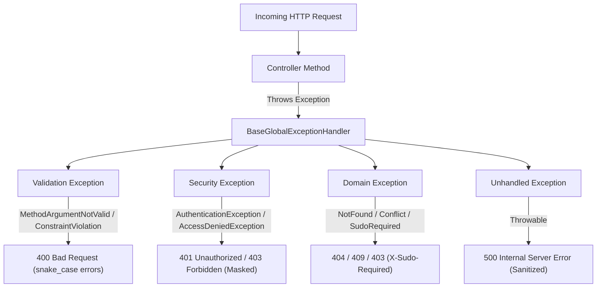
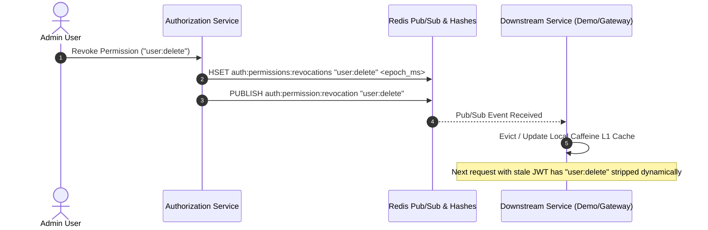

# Vaultix Common Library - Modules & Capabilities

Comprehensive technical guide and API reference for all shared components, cryptographic utilities, distributed security suites, and messaging contracts within the **Vaultix Common Library** (`com.vaultix:common`).

---

## Table of Contents
1. [Unified API Protocol (`ApiResponse<T>`)](#1-unified-api-protocol-apiresponset)
2. [Centralized Exception Handling (`BaseGlobalExceptionHandler`)](#2-centralized-exception-handling-baseglobalexceptionhandler)
3. [Pure Java Cryptographic Suite](#3-pure-java-cryptographic-suite)
   - [AES-256 GCM Authenticated Encryption (`AesGcmCryptoUtil`)](#aes-256-gcm-authenticated-encryption-aesgcmcryptoutil)
   - [RFC 6238/4226 TOTP Engine (`TotpUtil`)](#rfc-62384226-totp-engine-totputil)
   - [MFA Emergency Recovery Codes (`RecoveryCodeUtil`)](#mfa-emergency-recovery-codes-recoverycodeutil)
4. [High-Performance Edge Context & Identifiers](#4-high-performance-edge-context--identifiers)
   - [Gateway Context Resolution (`ClientContextUtil`)](#gateway-context-resolution-clientcontextutil)
   - [PII Masking Utilities (`MaskUtil`)](#pii-masking-utilities-maskutil)
   - [Fast UUID Parsing & Inspection (`UuidUtils`)](#fast-uuid-parsing--inspection-uuidutils)
5. [Spring Security & OAuth2 Resource Server Suite](#5-spring-security--oauth2-resource-server-suite)
   - [JWT Decoder Factory (`CommonJwtDecoderFactory`)](#jwt-decoder-factory-commonjwtdecoderfactory)
   - [Custom Authentication Converter (`CustomJwtAuthenticationConverter`)](#custom-authentication-converter-customjwtauthenticationconverter)
   - [Token Blacklist Validator (`JwtBlacklistValidator`)](#token-blacklist-validator-jwtblacklistvalidator)
   - [Security Utilities (`SecurityUtil` & `CommonSecurityExpressions`)](#security-utilities-securityutil--commonsecurityexpressions)
   - [Entry Points & Access Denied Handlers](#entry-points--access-denied-handlers)
6. [Distributed Invalidation & Revocation Engine](#6-distributed-invalidation--revocation-engine)
   - [Token Blacklist Store (`RedisTokenBlacklistService`)](#token-blacklist-store-redistokenblacklistservice)
   - [Permission Revocation Store (`RedisPermissionRevocationService`)](#permission-revocation-store-redispermissionrevocationservice)
   - [Role Revocation Store (`RedisRoleRevocationService`)](#role-revocation-store-redisrolerevocationservice)
   - [Redis Pub/Sub Helper (`RedisPubSubHelper` & `SecurityTopics`)](#redis-pubsub-helper-redispubsubhelper--securitytopics)
7. [Enterprise Sudo Session Elevation](#7-enterprise-sudo-session-elevation)
   - [Sudo Service Contract & Redis Implementation](#sudo-service-contract--redis-implementation)
   - [Sudo Annotation (`@RequireSudo`)](#sudo-annotation-requiresudo)
   - [AOP Sudo Enforcement (`RequireSudoAspect`)](#aop-sudo-enforcement-requiresudoaspect)
8. [Cross-Service Messaging Contracts](#8-cross-service-messaging-contracts)
   - [Notification Channel Enum (`NotificationChannel`)](#notification-channel-enum-notificationchannel)
   - [Notification Event Record (`NotificationEvent`)](#notification-event-record-notificationevent)

---

## 1. Unified API Protocol (`ApiResponse<T>`)

Standardized JSON envelope used across every endpoint in the Vaultix ecosystem to ensure client consistency and deterministic error handling.

### JSON Representation
```json
{
  "success": true,
  "message": "Operation completed successfully",
  "data": {
    "id": "550e8400-e29b-41d4-a716-446655440000",
    "email": "user@vaultix.io"
  },
  "timestamp": "2026-11-01T14:00:00Z"
}
```

When an operation fails or validation errors occur:
```json
{
  "success": false,
  "message": "Validation failed",
  "errors": {
    "email": "Email address must be well-formed",
    "password": "Password must be at least 8 characters"
  },
  "timestamp": "2026-11-01T14:00:00Z"
}
```

### Class Design & Features
- **Java 27 Record**: Declared as `public record ApiResponse<T>(boolean success, String message, T data, Map<String, String> errors, Instant timestamp)`.
- **Jackson Inclusions**: Decorated with `@JsonInclude(JsonInclude.Include.NON_NULL)` so null fields are stripped from serializations.
- **Compact Constructor**: Guarantees `timestamp` defaults to `Instant.now()` if null during manual construction or builder invocations.
- **Static Factory Helpers**:
  - `ApiResponse.success(T data)`: Defaults message to `"Operation successful"`.
  - `ApiResponse.success(String message, T data)`: Custom success message with payload.
  - `ApiResponse.success(String message)`: Void success message.
  - `ApiResponse.error(String message)`: Single error message.
  - `ApiResponse.error(String message, Map<String, String> errors)`: Detailed error map.

### Common Gateway Headers (`CommonHeaders`)
Constants representing headers injected by the Vaultix Gateway:
- `CommonHeaders.X_CLIENT_IP = "X-Client-IP"`
- `CommonHeaders.X_DEVICE_INFO = "X-Device-Info"`
- `CommonHeaders.X_DEVICE_LOCATION = "X-Device-Location"`

---

## 2. Centralized Exception Handling (`BaseGlobalExceptionHandler`)

An abstract `@RestControllerAdvice` base class designed for inheritance by microservices (`authorization`, `gateway`, `notification`, `demo`), transforming runtime and framework exceptions into uniform `ApiResponse<Void>` payloads.



### Exception Mapping Reference

| Exception Class | HTTP Status | Response Details |
| :--- | :---: | :--- |
| `MethodArgumentNotValidException` | `400 BAD_REQUEST` | Resolves target DTO `@JsonProperty` annotations or applies cached `snake_case` normalization to field names. |
| `HandlerMethodValidationException` | `400 BAD_REQUEST` | Handles Spring 6.1+ method parameter validation violations (`@RequestParam`, `@PathVariable`). |
| `ConstraintViolationException` | `400 BAD_REQUEST` | Extracts violation property paths, trims class prefixes, and normalizes to `snake_case`. |
| `MethodArgumentTypeMismatchException` | `400 BAD_REQUEST` | Produces readable type mismatch errors: `"Parameter 'param_name' should be of type Integer"`. |
| `HttpMessageNotReadableException` | `400 BAD_REQUEST` | Sanitizes parser errors to `"Malformed JSON request body"` to prevent leaking backend classes. |
| `HttpRequestMethodNotSupportedException` | `405 METHOD_NOT_ALLOWED` | Returns method not supported message. |
| `NoResourceFoundException` | `404 NOT_FOUND` | Standard Spring 6.1+ static or handler routing misses. |
| `AuthenticationException` | `401 UNAUTHORIZED` | Returns `"Authentication failed"`. Specifically masks `InternalAuthenticationServiceException` to protect database secrets. |
| `AccessDeniedException` | `403 FORBIDDEN` | Emits custom message if explicit, or defaults to `"Access denied: You do not have permission to access this resource"`. |
| `SudoRequiredException` | `403 FORBIDDEN` | Appends header `X-Sudo-Required: true` and includes `errors: { "code": "SUDO_REQUIRED" }`. |
| `BadRequestException` | `400 BAD_REQUEST` | Business rule validation failures. |
| `ResourceNotFoundException` | `404 NOT_FOUND` | Entity lookup misses. |
| `ResourceConflictException` | `409 CONFLICT` | State conflicts (e.g. duplicate email, unique constraint violations). |
| `Exception` (catch-all) | `500 INTERNAL_SERVER_ERROR` | Logs the full stack trace securely on the server while returning a sanitized `"Internal server error"` to the caller. |

---

## 3. Pure Java Cryptographic Suite

Stateless, zero-external-dependency cryptographic implementations adhering strictly to security best practices and NIST/RFC standards.

### AES-256 GCM Authenticated Encryption (`AesGcmCryptoUtil`)
- **Algorithm**: `AES/GCM/NoPadding` with 256-bit key length.
- **IV Specifications**: Generates a cryptographically secure 12-byte initialization vector (`GCM_IV_LENGTH_BYTES = 12`) per encryption call via `SecureRandom`.
- **Authentication Tag**: Uses 128-bit authentication tags (`GCM_TAG_LENGTH_BITS = 128`).
- **Wire Format**: Emits URL-safe Base64 containing the 12-byte IV prepended to the ciphertext and authentication tag.
- **Key Utilities**:
  ```java
  /* Generate a fresh 256-bit AES key */
  SecretKey key = AesGcmCryptoUtil.generateKey();
  String base64Key = AesGcmCryptoUtil.generateKeyAsBase64();

  /* Encrypt plaintext */
  String ciphertext = AesGcmCryptoUtil.encrypt("sensitive-user-token", key);

  /* Decrypt ciphertext */
  String decrypted = AesGcmCryptoUtil.decrypt(ciphertext, key);
  ```

### RFC 6238/4226 TOTP Engine (`TotpUtil`)
- **Specification**: Complete implementation of Time-Based One-Time Passwords (RFC 6238) and HMAC-Based One-Time Passwords (RFC 4226).
- **Zero Dependencies**: Pure JDK `javax.crypto.Mac` implementation with native RFC 4648 Base32 encoding and decoding.
- **Parameters**: 6 digits, 30-second time-step period, 160-bit secret keys (20 bytes), and `HmacSHA1`.
- **Google Authenticator URI**: Generates valid `otpauth://totp/Vaultix:user@example.com?secret=...&issuer=Vaultix` URLs.
- **Constant-Time Verification**: Uses `MessageDigest.isEqual` to prevent timing attacks.
- **Replay Protection**:
  ```java
  /* Verifies code within window and returns the counter step to prevent replay attacks */
  OptionalLong validStep = TotpUtil.verifyCodeAndGetStep(secret, userCode, 1);
  if (validStep.isPresent()) {
      long step = validStep.getAsLong();
      /* Ensure step > lastUsedStep in Redis or database */
  }
  ```

### MFA Emergency Recovery Codes (`RecoveryCodeUtil`)
- **High-Entropy Crockford Alphabet**: Uses an unambiguous 32-character alphabet (`23456789abcdefghjkmnpqrstuvwxyz`) that completely excludes visually ambiguous characters (`0/O`, `1/I/l`, `8/B`).
- **Formatting**: Generates codes formatted in balanced groups (e.g., `abcde-12345`).
- **Normalization**: `RecoveryCodeUtil.normalizeCode(input)` strips hyphens, removes whitespace, and converts to lowercase for uniform database comparison.

---

## 4. High-Performance Edge Context & Identifiers

### Gateway Context Resolution (`ClientContextUtil`)
Extracts and sanitizes network and client identity headers forwarded by the API Gateway:
```java
ClientContext context = ClientContextUtil.extract(httpServletRequest);
String ip = context.ip();              /* e.g. "203.0.113.195" */
String device = context.deviceInfo();  /* e.g. "Chrome 130 on Windows 11" */
String location = context.location();  /* e.g. "San Francisco, US" */
```
- **Fallback**: Falls back to `request.getRemoteAddr()` if `X-Client-IP` is absent.
- **Multi-Proxy Safety**: Automatically strips comma-delimited proxy chains, extracting the client IP safely.
- **Immutable Constant**: Provides `ClientContext.EMPTY` to avoid object allocation in unauthenticated or internal requests.

### PII Masking Utilities (`MaskUtil`)
Centralized data-masking routines to prevent accidental leakage of sensitive identifiers in logs, alerts, and previews:
- **Email Masking**: `MaskUtil.maskEmail("john.doe@company.com")` &rarr; `"j***e@company.com"`. Handles short local parts safely (`a@example.com` &rarr; `"a***@example.com"`).
- **Phone Masking**: `MaskUtil.maskPhone("+1 (555) 234-5678")` &rarr; `"••••••••78"`. Preserves only the last 2 digits matching Google Account privacy standards, omitting country codes.
- **Username Masking**: `MaskUtil.maskUsername("johndoe")` &rarr; `"j***e"`. Automatically detects `@` symbols and delegates to `maskEmail`.

### Fast UUID Parsing & Inspection (`UuidUtils`)
High-throughput UUID operations optimized to avoid expensive `IllegalArgumentException` stack trace generation:
```java
/* Fast character inspection without allocating or parsing */
boolean plausible = UuidUtils.isPotentialUuid(input);

/* Safe parsing returning Optional<UUID> */
Optional<UUID> maybeUuid = UuidUtils.parseUuid(input);

/* Boolean check */
boolean valid = UuidUtils.isUuid(input);
```

---

## 5. Spring Security & OAuth2 Resource Server Suite

A unified resource server architecture decoupling downstream microservices from security token decoding complexities while enforcing strict token validity.

### JWT Decoder Factory (`CommonJwtDecoderFactory`)
Fluent Lombok builders constructing `NimbusJwtDecoder` instances with production-grade security:

```java
/* Option A: Remote JWKS discovery with Spring Cache (Gateway, Demo, etc.) */
JwtDecoder remoteDecoder = CommonJwtDecoderFactory.withJwkSetUri()
        .jwkSetUri("http://authorization-service/.well-known/jwks.json")
        .cache(caffeineCache)
        .expectedIssuer("https://auth.vaultix.io")
        .blacklistValidator(jwtBlacklistValidator)
        .build();

/* Option B: In-Memory JWKSource (Used inside Authorization service) */
JwtDecoder localDecoder = CommonJwtDecoderFactory.withJwkSource()
        .jwkSource(inMemoryJwkSource)
        .expectedIssuer("https://auth.vaultix.io")
        .blacklistValidator(jwtBlacklistValidator)
        .build();
```

### Custom Authentication Converter (`CustomJwtAuthenticationConverter`)
Maps the custom `roles_permissions` claims from Vaultix access tokens directly into Spring Security `GrantedAuthority` collections (`ROLE_<NAME>` and `<PERMISSION_NAME>`):
- **Live Revocation Verification**: Consults `RoleRevocationService` and `PermissionRevocationService` against the token's `iat` (issued-at) timestamp. If a role or permission was revoked after the token was minted, the authority is dynamically stripped on the fly without waiting for token expiration.
- **Actor Principal**: Sets the authenticated principal to the actor UUID extracted from the token subject.

### Token Blacklist Validator (`JwtBlacklistValidator`)
An `OAuth2TokenValidator<Jwt>` executing during the JWT decoding pipeline:
- Extracts the `jti` (JWT ID) claim.
- Queries `TokenBlacklistService.isBlacklisted(jti)`.
- Rejects blacklisted tokens immediately with `OAuth2Error("invalid_token", "Token has been revoked", null)`.

### Security Utilities (`SecurityUtil` & `CommonSecurityExpressions`)
- `SecurityUtil.extractJwt(Authentication)`: Extracts `Jwt` from Spring Security context.
- `SecurityUtil.extractActorId(Jwt)`: Parses the subject UUID. Throws `BadCredentialsException` if missing or malformed.
- `SecurityUtil.extractSessionId(Jwt)`: Parses the `sid` claim UUID identifying the user session.
- `SecurityUtil.extractTokenId(Jwt)` / `extractJti(Jwt)`: Parses the `jti` token UUID.
- `CommonSecurityExpressions.IS_ADMIN = "hasRole('ADMIN')"`: Type-safe SpEL constant for `@PreAuthorize(CommonSecurityExpressions.IS_ADMIN)`.

### Entry Points & Access Denied Handlers
- **`CustomAuthenticationEntryPoint`**: Emits `401 Unauthorized` adhering to `ApiResponse.error("Authentication required")`.
- **`CustomAccessDeniedHandler`**: Emits `403 Forbidden` adhering to `ApiResponse.error("Access denied: You do not have permission to access this resource")`.

---

## 6. Distributed Invalidation & Revocation Engine

Enforces near-instant revocation of JWT tokens, user permissions, and user roles across distributed service instances using Redis and local Caffeine caches.



### Token Blacklist Store (`RedisTokenBlacklistService`)
- **Key Structure**: `auth:blacklist:token:<jti>`.
- **Automatic TTL**: Writes with an exact TTL matching the remaining token lifetime. When the token expires naturally, Redis evicts the key automatically.
- **Pipelined Batching**: `blacklistAll(Collection<String> jtis, Duration ttl)` leverages Redis pipelining for high-performance session logout operations.

### Permission Revocation Store (`RedisPermissionRevocationService`)
- **Redis Hash**: `auth:permissions:revocations`. Field is permission name, value is epoch millisecond timestamp.
- **L1 Caffeine Cache**: Local cache prevents Redis round-trips on every request.
- **Startup Synchronization**: Implements Spring's `ApplicationRunner` to pre-warm the local Caffeine cache from Redis on application boot.
- **Real-Time Pub/Sub**: Invalidate listener updates the local cache when revocation events arrive.

### Role Revocation Store (`RedisRoleRevocationService`)
- **Redis Hash**: `auth:roles:revocations`.
- Mirrors the two-tier caching and startup synchronization architecture of the permission service for role-level revocation.

### Redis Pub/Sub Helper (`RedisPubSubHelper` & `SecurityTopics`)
Fluent builder attaching typed listeners to Redis pub/sub topics:
```java
RedisPubSubHelper.builder()
        .container(redisMessageListenerContainer)
        .topicName(SecurityTopics.PERMISSION_REVOCATION)
        .onMessage(permissionRevocationService::handleRevocationEvent)
        .build();
```

**Channel Constants (`SecurityTopics`)**:
- `SecurityTopics.SIGNING_KEY_REVOCATION = "auth:signing-key:revocation"`
- `SecurityTopics.PERMISSION_REVOCATION = "auth:permission:revocation"`
- `SecurityTopics.ROLE_REVOCATION = "auth:role:revocation"`

---

## 7. Enterprise Sudo Session Elevation

Provides step-up authentication protection for sensitive operations (e.g. deleting keys, modifying MFA, resetting credentials) without re-authenticating on every click.

### Sudo Service Contract & Redis Implementation
- **Contract (`SudoService`)**:
  - `elevateSudo(UUID sessionId)`: Elevates session for default duration (5 minutes).
  - `elevateSudo(UUID sessionId, Duration ttl)`: Elevates session for custom duration.
  - `isSudoActive(UUID sessionId)`: Verifies if elevation is active.
  - `isSudoActive(UUID sessionId, long maxAgeSeconds)`: Verifies elevation is fresh within `maxAgeSeconds`.
  - `revokeSudo(UUID sessionId)`: Explicitly terminates elevation.
- **Redis Keyspace (`RedisSudoService`)**:
  - Key: `auth:sudo:session:<sessionId>`.
  - Value: String epoch milliseconds timestamp of when elevation occurred.
  - Redis TTL: Equal to the elevation duration.

### Sudo Annotation (`@RequireSudo`)
Annotates controller methods or entire controller classes:
```java
@Target({ElementType.METHOD, ElementType.TYPE})
@Retention(RetentionPolicy.RUNTIME)
public @interface RequireSudo {
    /* Maximum age in seconds allowed for elevation (0 = global default) */
    long maxAgeSeconds() default 0;
}
```

### AOP Sudo Enforcement (`RequireSudoAspect`)
Spring AOP aspect intercepting calls to methods annotated with `@RequireSudo`:
1. Extracts `Authentication` from `SecurityContextHolder`.
2. Extracts session UUID (`sid` claim) via `SecurityUtil.extractSessionId(authentication)`.
3. Calls `sudoService.isSudoActive(sessionId, maxAgeSeconds)`.
4. If invalid or expired, throws `SudoRequiredException`.
5. `BaseGlobalExceptionHandler` intercepts `SudoRequiredException`, responding with:
   - Status: `403 Forbidden`
   - Header: `X-Sudo-Required: true`
   - Body:
     ```json
     {
       "success": false,
       "message": "This action requires elevated sudo authentication",
       "errors": {
         "code": "SUDO_REQUIRED"
       },
       "timestamp": "2026-11-01T14:00:00Z"
     }
     ```

---

## 8. Cross-Service Messaging Contracts

Type-safe, immutable DTO records ensuring seamless integration between producer services (`authorization`) and consumer services (`notification`) over RabbitMQ.

### Notification Channel Enum (`NotificationChannel`)
```java
public enum NotificationChannel {
    EMAIL,
    SMS,
    PUSH,
    IN_APP
}
```

### Notification Event Record (`NotificationEvent`)
A Bean-validated record payload dispatched across message queues:

```java
@Builder
public record NotificationEvent(
        @NotNull UUID eventId,
        @NotBlank @Pattern(regexp = "^[a-z0-9]+([._-][a-z0-9]+)*$") String templateCode,
        @NotNull NotificationChannel channel,
        @NotBlank @Size(max = 256) String recipient,
        @NotBlank @Size(max = 256) String recipientName,
        @NotBlank @Size(max = 256) String subject,
        @NotNull Map<String, Object> params,
        @NotNull Instant createdAt
) {}
```

### Publishing an Event Example:
```java
NotificationEvent event = NotificationEvent.builder()
        .eventId(UUID.randomUUID())
        .templateCode("auth.password-reset")
        .channel(NotificationChannel.EMAIL)
        .recipient(user.getEmail())
        .recipientName(user.getDisplayName())
        .subject("Reset Your Vaultix Password")
        .params(Map.of("reset_url", resetLink, "expires_in", "15 minutes"))
        .createdAt(Instant.now())
        .build();

rabbitTemplate.convertAndSend("vaultix.notification.exchange", "notification.email", event);
```
